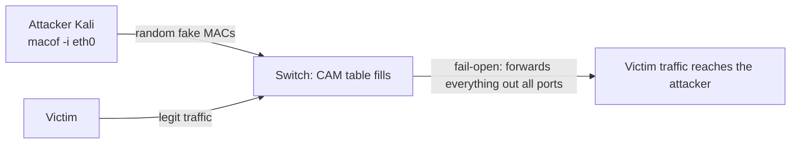

# Cisco Port Security: MAC Flooding Mitigation

- **Date:** 2026-08-19
- **Source:** Luis, lab on a Cisco switch with Kali: `macof` attack and Port Security defense.
- **Status:** Working. `macof` flooding is blocked once Port Security is on.

## Goal

Test a MAC flooding attack against a Cisco switch CAM table and stop it with Port Security on the port:

1. Fill the CAM table from Kali with `macof` and watch the switch fall into fail-open (forwards all traffic out all ports).
2. Configure Port Security to limit MACs per port and set the violation mode.
3. Verify the attack stops working.

## Background

The CAM table (Content Addressable Memory), also called the MAC address table, maps each source MAC to the port it was learned on. That lets the switch forward each frame only out the right port. Its capacity is limited.

MAC flooding stuffs the table with thousands of fake MACs until it is full. The switch goes fail-open: it no longer knows which port each frame belongs to, so it floods every port like a hub. At that point the attacker can capture other machines' traffic.

`macof` (dsniff package, included in Kali) generates bursts of Ethernet frames with random source MACs. Usage: `macof -i eth0`.

Port Security limits how many MACs a port can learn and what happens past that limit:

- `protect`: drops frames from unauthorized MACs without notification. The port stays up.
- `restrict`: drops frames and notifies via syslog/SNMP, bumping the violation counter.
- `shutdown` (default): disables the port (errdisable / Secure-shutdown) until manual intervention.
- Sticky MAC: dynamically learned MACs become static and persist in the running-config, surviving a reboot.

## Procedure

### 1. The attack: MAC flooding from Kali

With Kali plugged into a switch port:

```bash
macof -i eth0
```

`macof` generates hundreds of frames per second with random source MACs. The switch learns them until the CAM table is full; with no room left, it stops learning and starts flooding all traffic out all ports.



Effect: the switch acts like a hub and the attacker can capture victim traffic (sniffing / L2 MITM).

### 2. The defense: Port Security on the switch

Sequence from the switch:

```cisco
enable
show mac address-table
configure terminal
interface ethernet 0/1
switchport mode access
switchport port-security
```

| Command | What it does |
|---|---|
| `enable` (`ena`) | Enter privileged EXEC mode |
| `show mac address-table` | Show the current CAM table |
| `configure terminal` (`conf t`) | Enter global configuration mode |
| `interface ethernet 0/1` | Select the port to protect |
| `switchport mode access` | Set the port as access (required for Port Security) |
| `switchport port-security` | Enable port security (default: max 1 MAC, violation = shutdown) |

### 3. Verification

```cisco
show port-security
show port-security interface ethernet 0/1
show mac address-table
```

## Examples

### Example 1: attack with `macof` (Kali)

```bash
# From the attacker machine (Kali)
sudo macof -i eth0
```

While the attack runs, the switch CAM table fills with fake dynamic entries:

```cisco
Switch# show mac address-table
Mac Address Table
-------------------------------------------
Vlan    Mac Address       Type        Ports
----    -----------       --------    -----
   1    0011.2233.4455    DYNAMIC     Et0/1
   1    00aa.bbcc.ddee    DYNAMIC     Et0/1
   1    1122.3344.5566    DYNAMIC     Et0/1
   1    2233.4455.6677    DYNAMIC     Et0/1
...  (table saturated with fake MACs)
```

### Example 2: full defensive config (switch)

```cisco
Switch> enable
Switch# configure terminal
Switch(config)# interface ethernet 0/1
Switch(config-if)# switchport mode access
Switch(config-if)# switchport port-security
Switch(config-if)# switchport port-security maximum 2
Switch(config-if)# switchport port-security violation restrict
Switch(config-if)# switchport port-security mac-address sticky
Switch(config-if)# end
```

- `maximum 2`: only 2 MACs can be learned on that port.
- `violation restrict`: an extra MAC is dropped and the violation is logged; the port stays up.
- `mac-address sticky`: learned MACs get pinned in the config.

### Example 3: violation and recovery

If `macof` runs against a protected port in `shutdown` mode, the port goes down:

```cisco
Switch# show port-security interface ethernet 0/1
Port Security              : Enabled
Port Status                : Secure-shutdown
Violation Mode             : Shutdown
Maximum MAC Addresses      : 1
Total MAC Addresses        : 1
Security Violation Count   : 1
```

To bring the port back:

```cisco
Switch(config)# interface ethernet 0/1
Switch(config-if)# shutdown
Switch(config-if)# no shutdown
```

Or with automatic recovery:

```cisco
Switch(config)# errdisable recovery cause psecure-violation
Switch(config)# errdisable recovery interval 300
```

## Conclusion

With Port Security on, `macof` flooding can no longer fill the CAM table: extra MACs get dropped or the port goes down, and the table only holds authorized MACs.
