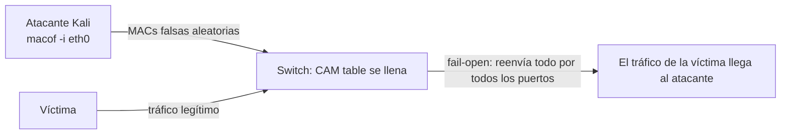

# Port Security en Cisco: mitigación de MAC flooding

- **Fecha:** 2026-08-19
- **Fuente:** Luis, laboratorio sobre un switch Cisco con Kali: ataque con `macof` y defensa con Port Security.
- **Estado:** Funcionando. El flooding de `macof` queda bloqueado con Port Security.

## Objetivo

Probar el ataque de MAC flooding contra la CAM table de un switch Cisco y frenarlo configurando Port Security en el puerto:

1. Llenar la CAM table desde Kali con `macof` y ver el switch pasar a fail-open (reenvía todo el tráfico por todos los puertos).
2. Configurar Port Security para limitar las MAC por puerto y definir el modo de violación.
3. Verificar que el ataque deja de funcionar.

## Contexto

La CAM table (Content Addressable Memory), también llamada MAC address table, asocia cada MAC de origen con el puerto por el que se aprendió. Así el switch reenvía cada trama solo por el puerto correcto. Su capacidad es limitada.

MAC flooding inunda esa tabla con miles de MAC falsas hasta llenarla. El switch entra en fail-open: deja de saber por qué puerto va cada trama y la reenvía por todos, como un hub. En ese momento el atacante puede capturar el tráfico de otras máquinas.

`macof` (paquete dsniff, incluido en Kali) genera ráfagas de tramas Ethernet con MAC de origen aleatorias. Uso: `macof -i eth0`.

Port Security limita cuántas MAC puede aprender un puerto y qué hacer al superar ese límite:

- `protect`: descarta las tramas de MAC no autorizadas, sin notificación. El puerto sigue activo.
- `restrict`: descarta las tramas y notifica por syslog/SNMP, incrementando el contador de violaciones.
- `shutdown` (por defecto): desactiva el puerto (estado errdisable / Secure-shutdown) hasta intervención manual.
- Sticky MAC: las MAC aprendidas dinámicamente se convierten en estáticas y quedan en la running-config, así sobreviven al reinicio.

## Procedimiento

### 1. El ataque: MAC flooding desde Kali

Con la máquina conectada a un puerto del switch:

```bash
macof -i eth0
```

`macof` genera cientos de tramas por segundo con MAC de origen aleatorias. El switch las va aprendiendo hasta llenar la CAM table; sin espacio, deja de aprender y empieza a inundar todo el tráfico por todos los puertos.



Efecto: el switch actúa como un hub y el atacante puede capturar el tráfico de las víctimas (sniffing / MITM en capa 2).

### 2. La defensa: Port Security en el switch

Secuencia desde el switch:

```cisco
enable
show mac address-table
configure terminal
interface ethernet 0/1
switchport mode access
switchport port-security
```

| Comando | Qué hace |
|---|---|
| `enable` (`ena`) | Pasa a modo privilegiado (privileged EXEC) |
| `show mac address-table` | Muestra la CAM table actual del switch |
| `configure terminal` (`conf t`) | Entra al modo de configuración global |
| `interface ethernet 0/1` | Selecciona el puerto a proteger |
| `switchport mode access` | Define el puerto como access (requisito para Port Security) |
| `switchport port-security` | Habilita la seguridad de puerto (por defecto: máximo 1 MAC, violación = shutdown) |

### 3. Verificación

```cisco
show port-security
show port-security interface ethernet 0/1
show mac address-table
```

## Ejemplos

### Ejemplo 1: ataque con `macof` (Kali)

```bash
# Desde la máquina atacante (Kali)
sudo macof -i eth0
```

Mientras corre el ataque, la CAM table del switch se llena de entradas dinámicas falsas:

```cisco
Switch# show mac address-table
Mac Address Table
-------------------------------------------
Vlan    Mac Address       Type        Ports
----    -----------       --------    -----
   1    0011.2233.4455    DYNAMIC     Et0/1
   1    00aa.bbcc.ddee    DYNAMIC     Et0/1
   1    1122.3344.5566    DYNAMIC     Et0/1
   1    2233.4455.6677    DYNAMIC     Et0/1
...  (tabla saturada con MACs falsas)
```

### Ejemplo 2: configuración defensiva completa (switch)

```cisco
Switch> enable
Switch# configure terminal
Switch(config)# interface ethernet 0/1
Switch(config-if)# switchport mode access
Switch(config-if)# switchport port-security
Switch(config-if)# switchport port-security maximum 2
Switch(config-if)# switchport port-security violation restrict
Switch(config-if)# switchport port-security mac-address sticky
Switch(config-if)# end
```

- `maximum 2`: solo 2 MAC pueden aprenderse en ese puerto.
- `violation restrict`: si llega una MAC extra, se descarta y se registra la violación; el puerto no se cae.
- `mac-address sticky`: las MAC aprendidas quedan fijas en la configuración.

### Ejemplo 3: violación y recuperación

Si `macof` corre contra un puerto protegido en modo `shutdown`, el puerto se desactiva:

```cisco
Switch# show port-security interface ethernet 0/1
Port Security              : Enabled
Port Status                : Secure-shutdown
Violation Mode             : Shutdown
Maximum MAC Addresses      : 1
Total MAC Addresses        : 1
Security Violation Count   : 1
```

Para recuperar el puerto:

```cisco
Switch(config)# interface ethernet 0/1
Switch(config-if)# shutdown
Switch(config-if)# no shutdown
```

O con recuperación automática:

```cisco
Switch(config)# errdisable recovery cause psecure-violation
Switch(config)# errdisable recovery interval 300
```

## Conclusión

Con Port Security activo, el flooding de `macof` ya no puede llenar la CAM table: las MAC extra se descartan o apagan el puerto, y la tabla solo contiene las MAC autorizadas.
